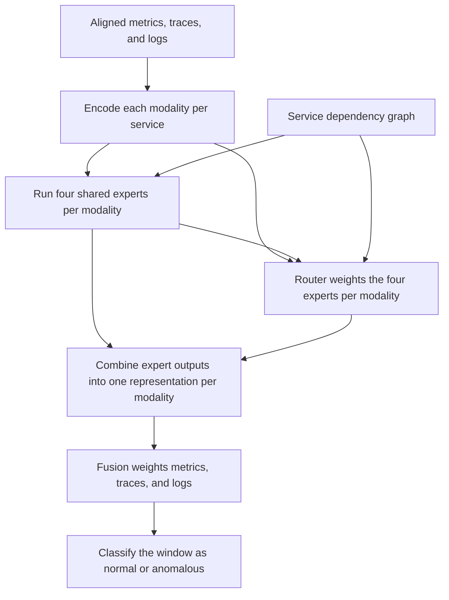

# UG-MoE for Multimodal Microservice Anomaly Detection

**Final-year BTP report**

**Student:** [Name] · **Roll number:** [Roll number]  
**Department:** [Department] · **Supervisor:** [Supervisor]

## 1. Abstract

UG-MoE v2 detects anomalies in 10-second windows of microservice metrics, traces, and logs. I rebuilt two Eadro datasets and evaluated UG-MoE and MUAD on the same recording-based splits. The audit found that 1,882 of 2,244 test windows in the recovered MUAD SocialNetwork split shared nine seconds of metric readings with a training window. Across five training seeds, UG-MoE achieved anomaly F1 of **0.9656 on SocialNetwork** and **0.7656 on TrainTicket**, versus **0.9075** and **0.6456** for MUAD. On TrainTicket, it detected more network faults and raised more false alarms.

## 2. Introduction and Motivation

### Why combine metrics, traces, and logs?

A service can slow down because a dependency is failing. For example, a caller may log timeouts while its CPU usage stays steady. A trace can show that requests spend most of their time waiting on a downstream service, whose metrics may show resource pressure. Metrics describe resource use, traces follow requests, and logs record discrete events. UG-MoE combines these signals using the service dependency graph.

### Project contributions

- Rebuilt two Eadro benchmarks into aligned, labeled windows with recording IDs and service graphs.
- Audited the recovered MUAD split and released code, then established a common evaluation protocol for the baseline and proposed models.
- Implemented UG-MoE v2 and evaluated its overall performance, sensitivity to missing and noisy inputs, and the effects of removing individual components.

## 3. Related Work

### MUAD and Eadro

MUAD combines separate telemetry encoders with a graph-based probabilistic encoder and confidence-aware fusion [1]. It is the main reference model for this project. Eadro provides the SocialNetwork and TrainTicket recordings used to test the detectors [2].

### Graph attention and mixtures of experts

Graph attention weights information from neighboring nodes [6]. In this project, those neighbors are services connected by a dependency. A mixture of experts uses a learned router to weight several networks [7]. UG-MoE applies that idea separately to metrics, traces, and logs. The GAT, Plain MoE, and Graph MoE baselines provide comparisons for these design choices [4, 5].

## 4. Problem Statement

### Inputs and output

The input is one 10-second window of metrics, trace latency, and log counts on a service graph. The output is one normal or anomalous label for the whole system. Ground truth comes from recorded CPU-load, network-delay, and network-loss injections.

### Scope

This is supervised anomaly detection. I used fault types to measure recall by fault category. Root-cause localization and active learning were beyond the scope of the experiments.

## 5. Proposed Approach

### Data preparation

I aligned the telemetry on a one-second grid and marked a window anomalous if it overlapped an injected fault by at least one second. Each service contributes seven container metrics, a summary of span latency, and counts of Drain3 log templates. I fitted normalization on training data and reused the same statistics for validation and test [2, 4].

### Four shared experts

The experts give the router four ways to examine the same window. It can weight them differently for each telemetry type and window [4].

| Expert | Why it is included |
|---|---|
| Temporal GRU | A fault may show up as a sudden jump or a gradual change within one service. The GRU uses the order of observations. |
| Semantic self-attention | Services can show related patterns even when they have no direct graph edge. Self-attention compares them using their features. |
| Dependency GATv2 | A fault can affect services that call the failing component. GATv2 uses the known dependency edges to pass information between services. |
| Cross-modal attention | A latency jump is easier to interpret alongside a CPU spike or a timeout log. This expert relates the telemetry streams for the same service. |

### Uncertainty-guided routing and fusion

Each expert produces a mean and log-variance. For each telemetry type, the router uses the features, graph context, and estimated uncertainty to weight the four expert outputs. A second set of weights combines the three telemetry representations for classification. I trained with cross-entropy and a Gaussian KL regularizer and used the latent mean at test time [4].

**Figure 1.** Routing combines expert outputs within each modality. Fusion combines the three modalities for the final prediction.

## 6. Experiments and Results

### Datasets, splits, and metrics

All comparison models use the same train, validation, and test partitions. Fault-injection runs are assigned whole, with later runs held out. SocialNetwork includes a separate fault-free run in each split. TrainTicket's two fault-free runs are segmented chronologically, and windows spanning a cut are discarded. Anomaly F1 is the main test metric because the project aims to detect faults. It combines anomaly precision and recall. I selected checkpoints by validation macro-F1 and report test macro-F1 alongside anomaly F1 to show performance across both classes [4].

| Benchmark | Fault / fault-free recordings | Services / edges | Window / stride | Train / validation / test windows |
|---|---:|---:|---:|---:|
| SocialNetwork (SN) | 4 / 3 | 12 / 24 | 10 s / 1 s | 4,236 / 2,834 / 2,837 |
| TrainTicket (TT) | 9 / 2 | 27 / 44 | 10 s / 5 s | 8,397 / 3,228 / 3,226 |

### MUAD audit and evaluation changes

With a one-second stride, windows covering seconds 1–10 and 2–11 share nine seconds. A random window split can therefore put the same metric readings in training and test. I matched neighboring windows in the recovered files and inspected the released training code [1, 3].

| Finding | Project response |
|---|---|
| In the recovered SocialNetwork split, **83.87% of test windows** (1,882 of 2,244) had a training neighbor sharing nine of ten seconds of metrics. | Keep fault recordings in separate sets. For TrainTicket's fault-free recordings, use nonoverlapping time blocks and discard windows that cross the cuts. |
| The released MUAD trainer chooses its checkpoint using test F1. | Use validation macro-F1 to select checkpoints for all compared models. Use the test set for final scoring. |
| On the recovered test set, an always-anomalous predictor gets **0.9064 anomaly F1** and **0.4532 macro-F1**. | Report anomaly F1 alongside macro-F1 and the constant baseline to show how well the model handles normal windows. |
| MUAD's released model mixes up variance and log-variance in its uncertainty penalty and samples at prediction time. | UG-MoE v2 uses the correct Gaussian KL formula and uses the latent mean in evaluation. The MUAD baseline retains its published implementation's sampling and KL behavior. |

In the local audit, MUAD scored **0.9882 anomaly F1** on the recovered random split and **0.9767** on a whole-recording split of the recovered data. The second run also changed normalization and which windows were tested, so the score drop does not isolate the impact of overlap. The paper does not specify how it selected the checkpoint for its published score [1, 3].

### Final baseline comparison

Test scores are means ± standard deviations over five training seeds on fixed splits. The constant predictor has no training seed [5].

| Model | SN anomaly F1 | SN macro-F1 | TT anomaly F1 | TT macro-F1 |
| --- | ---: | ---: | ---: | ---: |
| Always predict anomaly | 0.5787 | 0.2893 | 0.8087 | 0.4044 |
| MUAD | 0.9075 ± 0.0065 | 0.9251 ± 0.0049 | 0.6456 ± 0.0491 | 0.6262 ± 0.0316 |
| GAT | 0.9136 ± 0.0451 | 0.9309 ± 0.0347 | 0.6917 ± 0.0606 | 0.6609 ± 0.0440 |
| Plain MoE | 0.9646 ± 0.0213 | 0.9709 ± 0.0170 | 0.7353 ± 0.0920 | 0.6981 ± 0.0727 |
| Graph MoE | 0.9509 ± 0.0222 | 0.9598 ± 0.0177 | 0.6883 ± 0.0875 | 0.6666 ± 0.0628 |
| **UG-MoE v2** | **0.9656 ± 0.0158** | **0.9715 ± 0.0128** | **0.7656 ± 0.1169** | **0.7234 ± 0.0899** |

Compared with MUAD, UG-MoE gained **5.8 anomaly F1 points on SN** and **12.0 points on TT**. The supporting macro-F1 comparisons had paired p-values of **0.0021 (SN)** and **0.0420 (TT)**. UG-MoE used about **31% fewer parameters**. On SN, CPU-load recall rose from **65.8% to 98.4%**. On TT, recall rose from **33.1% to 59.4%** for network delay and from **27.3% to 50.8%** for network loss. TT false alarms rose from **10.9% to 18.3%**, and PR-AUC was close to MUAD's (**0.9167 vs. 0.9143**) [5].

**Additional test metrics for MUAD and UG-MoE v2 (five-seed means)** [5].

| Dataset and model | Precision | Recall | PR-AUC | ROC-AUC |
| --- | ---: | ---: | ---: | ---: |
| SN, MUAD | 0.9699 | 0.8530 | 0.9679 | 0.9649 |
| SN, UG-MoE v2 | 0.9896 | 0.9430 | 0.9963 | 0.9977 |
| TT, MUAD | 0.9082 | 0.5041 | 0.9143 | 0.8372 |
| TT, UG-MoE v2 | 0.9030 | 0.6997 | 0.9167 | 0.8283 |

### Component ablations

Five-seed mean anomaly F1 for each variant. The macro-F1 columns show the change in points from full UG-MoE v2 [5].

| Component removed | SN anomaly F1 | SN macro-F1 Δ | TT anomaly F1 | TT macro-F1 Δ |
| --- | ---: | ---: | ---: | ---: |
| Full model (reference) | 0.9656 | — | 0.7656 | — |
| Graph context and dependency expert | 0.9729 | +0.6 | 0.7901 | +1.8 |
| Mixture of experts | 0.9573 | −0.6 | 0.7790 | +0.1 |
| Dynamic routing | 0.9719 | +0.5 | 0.7047 | −5.0 |
| Uncertainty input to router | 0.9685 | +0.2 | 0.7312 | −2.6 |
| Probabilistic representation | 0.9757 | +0.8 | 0.7483 | −1.9 |
| Adaptive fusion | 0.9359 | −2.4 | 0.7221 | −3.3 |

Removing adaptive fusion reduced anomaly F1 on both datasets, from 0.9656 to 0.9359 on SN and from 0.7656 to 0.7221 on TT. Some other removals raised mean anomaly F1. The paired tests on macro-F1 all had p > 0.05 [5].

### Modality subsets

Each model was trained and tested with the listed inputs on SocialNetwork (seed 42). All three inputs performed best on both scores [5].

| Training inputs | SN anomaly F1 | SN macro-F1 |
| --- | ---: | ---: |
| Logs | 0.7788 | 0.8318 |
| Traces | 0.9232 | 0.9353 |
| Metrics | 0.8500 | 0.8829 |
| Traces + logs | 0.9237 | 0.9379 |
| Metrics + logs | 0.9499 | 0.9587 |
| Metrics + traces | 0.9120 | 0.9292 |
| All three | 0.9842 | 0.9868 |

### Missing and noisy inputs

Cells show five-seed means as **anomaly F1 (macro-F1)**. Masking zeros a service's input for a modality with the stated probability. Strong noise is Gaussian with a standard deviation twice the training standard deviation of each channel [5].

| Test condition | SN UG-MoE | SN MUAD | TT UG-MoE | TT MUAD |
| --- | ---: | ---: | ---: | ---: |
| 10% random masking | 0.931 (0.942) | 0.878 (0.898) | 0.812 (0.616) | 0.676 (0.622) |
| 20% random masking | 0.889 (0.903) | 0.831 (0.850) | 0.804 (0.573) | 0.706 (0.613) |
| 40% random masking | 0.797 (0.811) | 0.721 (0.710) | 0.785 (0.506) | 0.694 (0.568) |
| 60% random masking | 0.708 (0.696) | 0.645 (0.543) | 0.777 (0.471) | 0.616 (0.526) |
| Metrics removed | 0.545 (0.274) | 0.579 (0.289) | 0.706 (0.406) | 0.000 (0.243) |
| Traces removed | 0.968 (0.973) | 0.895 (0.915) | 0.759 (0.711) | 0.647 (0.628) |
| Logs removed | 0.960 (0.967) | 0.904 (0.922) | 0.720 (0.676) | 0.690 (0.654) |
| Strong noise on metrics | 0.834 (0.856) | 0.734 (0.784) | 0.744 (0.575) | 0.727 (0.548) |
| Strong noise on traces | 0.937 (0.941) | 0.890 (0.910) | 0.801 (0.651) | 0.645 (0.626) |
| Strong noise on logs | 0.965 (0.971) | 0.905 (0.923) | 0.827 (0.584) | 0.697 (0.659) |
| Strong noise on all three | 0.802 (0.808) | 0.687 (0.735) | 0.783 (0.470) | 0.749 (0.537) |

| SocialNetwork | TrainTicket |
|---|---|
|  |  |

**Figure 2.** Supporting macro-F1 curves show the effect of masking on both classes. The table above gives anomaly F1 first [5].

At 40% masking, the **mean relative anomaly-F1 drop** from clean SN was **17.6% for UG-MoE** and **20.5% for MUAD**. On TT, anomaly F1 rose by **4.9%** and **7.5%**, respectively, while **macro-F1 fell by 30.1% and 9.2%**. These are averages of the per-seed relative changes. The TT example shows why both classes matter under corruption [5].

Removing metrics brought UG-MoE close to the constant baseline on both datasets. Under strong all-stream noise on SN, the variant without probabilistic modeling scored **0.796 (0.810)**, close to the full model's **0.802 (0.808)**, in anomaly F1 (macro-F1). The source of the robustness gain remains unresolved [5].

### Expert routing and uncertainty

These measurements come from the seed-42 checkpoint [4, 5].

| Diagnostic | Observation |
|---|---|
| **Routing by fault type** | On SN, metrics favored the dependency expert for normal windows (0.87 mean weight), the cross-modal expert for CPU load (0.95), and the temporal expert for network faults (about 0.50). On TT, CPU-load metrics favored the semantic expert (0.996). |
| **Normalized routing entropy** | SN metrics were more concentrated than SN logs (0.41 vs. 0.97). A value of 0 means one expert receives all the weight, while 1 means uniform weights. |
| **Uncertainty and fusion** | With metric noise on SN, metric log-variance rose from −0.22 to −0.07 and fusion weight fell from 0.96 to 0.91. On TT, log noise reduced log-variance from −0.03 to −0.14 and increased the log weight from 0.11 to 0.65. Anomaly F1 fell from 0.894 to 0.817. |

### Hyperparameter sensitivity

One parameter was varied at a time on SocialNetwork (seed 42). **Bold** marks the default [5].

| Hyperparameter | Setting → anomaly F1 (macro-F1) |
| --- | --- |
| Number of experts | 1 → 0.8845 (0.9089) · 2 → 0.9861 (0.9883) · 3 → 0.9804 (0.9835) · **4 → 0.9842 (0.9868)** |
| Embedding dimension | 16 → 0.9758 (0.9798) · 32 → 0.9739 (0.9783) · **64 → 0.9842 (0.9868)** · 128 → 0.9672 (0.9728) |
| Window size (seconds) | 5 → 0.9464 (0.9563) · **10 → 0.9842 (0.9868)** · 20 → 0.9692 (0.9732) |
| Uncertainty-loss weight (KL) | 0.001 → 0.9746 (0.9787) · **0.01 → 0.9842 (0.9868)** · 0.1 → 0.9418 (0.9525) · 1 → 0.9668 (0.9724) |
| Routing temperature | 0.5 → 0.9626 (0.9690) · **1 → 0.9842 (0.9868)** · 2 → 0.9793 (0.9828) |
| Learning rate | 0.0001 → 0.9782 (0.9817) · **0.0005 → 0.9842 (0.9868)** · 0.001 → 0.9822 (0.9850) |

Compared with the default, anomaly F1 fell by **10.0 points** with one expert and **4.2 points** with KL weight 0.1. Two experts scored **0.9861**, close to the four-expert default of **0.9842**. I fixed the defaults before the sweep. These differences are from one seed [4, 5].

## 7. Discussion

On SocialNetwork, UG-MoE kept more of its clean anomaly F1 than MUAD at 40% masking. On TrainTicket, the same perturbation raised anomaly F1 and lowered macro-F1 for both models. This matters in practice because an anomaly detector also has to avoid flagging routine operation.

Plain MoE was close to the full model. Removing some components raised anomaly F1, while removing adaptive fusion lowered it on both benchmarks. The paired ablation tests used macro-F1 and were inconclusive over five seeds [5].

The five seeds share the same test recordings. TrainTicket's fault-free partitions come from separate segments of the same recordings, and trace coverage is sparse. The log template vocabulary was built without labels using all runs. A comparison with MUAD retrained with the corrected KL formula remains open [3–5].

## 8. Conclusions

UG-MoE v2 improved clean anomaly F1 over MUAD by 5.8 points on SocialNetwork and 12.0 on TrainTicket under the shared protocol. TrainTicket's false-alarm rate also increased, and removing metrics hurt performance on both datasets. The next test is whether the gains hold on more recordings and whether training with missing inputs improves performance when metrics are unavailable.

## References

1. H. Dou et al. *Uncertainty-Aware Multimodal Anomaly Detection for Microservice Systems With Active Learning*. IEEE Transactions on Services Computing, 2026. DOI 10.1109/TSC.2026.3672587. MUAD reference implementation.
2. C. Lee et al. *Eadro: An End-to-End Troubleshooting Framework for Microservices on Multi-Source Data*. ICSE, 2023. Benchmark dataset, Zenodo record 7615394.
3. *MUAD-gaps.md*. Baseline audit and reproducible checks.
4. *UG-MoE_Implementation_Report.md*. Data, model, evaluation protocol, and code references.
5. *UG-MoE consolidated experiment results*. 18 November 2026, 20:16.
6. P. Veličković et al. *Graph Attention Networks*. ICLR, 2018.
7. R. A. Jacobs et al. *Adaptive Mixtures of Local Experts*. Neural Computation, 1991.

## Appendix A. Reproducibility

The dataset metadata records the graph and input schema. Saved experiment runs contain split IDs, normalization statistics, per-seed metrics, and checkpoints. The main scripts are `build_eadro.py`, `run_baselines.py`, `run_robustness.py`, and `run_analysis.py`. The script `make_report.py` rebuilds the tables and plots from saved outputs [4, 5].
